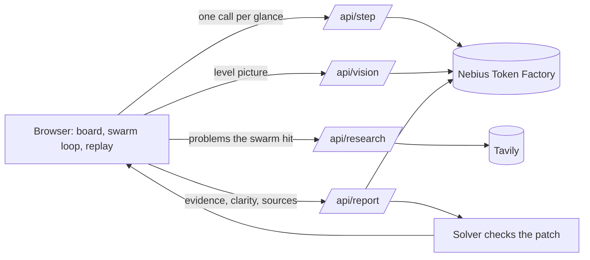

# Ghostplay

Nine AI playtesters play your game level, show you where players die and get stuck, fix the level, and prove the fix worked. Each playtester is an NVIDIA Nemotron model running on Nebius Token Factory, and the size of the model is the skill of the player.

[](LICENSE)

**Live demo:** https://ghostplay.vercel.app · **Video:** _added at submission_ · Built for the Nebius x NVIDIA Global AI Hackathon (Best Apps and Agents).

## The problem

I make small mobile and web games at StarFun Games. The difficulty spike that ruins level 3 is always found by players after launch, in one-star reviews, never by me: I know the level too well to play it like a stranger. Getting strangers is hard for a solo developer. Google Play even makes new personal developer accounts run a closed test with at least 12 testers for 14 days before they can publish.

Ghostplay gives you a first round of strangers in about a minute, for cents, before you spend those testers on it.

## What it does

1. **The swarm plays.** Nine ghosts play the level: three casual players, three core players and three experts. Each ghost sees the board as text (coordinates, spike timing, legal moves) and commits to its next one to four moves, the way a real player acts between glances.
2. **You see where it breaks.** Heatmaps of deaths, visits and wall bumps; completion by player type; a replay you can scrub turn by turn.
3. **A first-glance check.** A vision model looks at a picture of the level for "two seconds", like a new player, and says what is unclear.
4. **A genre lens.** Tavily searches and reads what players and designers say about the problems the swarm actually hit.
5. **A design report with a fix.** Nemotron Ultra reads every run and writes the issues, with evidence and tile coordinates, plus a patch of up to six tiles.
6. **The fix is proved, not suggested.** A breadth-first solver must show the patched level can still be finished before you can apply it. The same nine ghosts then replay it, and you get completion before and after.

You can paint your own level in the editor and run the whole loop on it.

## How it uses NVIDIA Nemotron and Nebius Token Factory

Every model call goes to the Token Factory OpenAI-compatible endpoint (`https://api.tokenfactory.nebius.com/v1`) in [`lib/nebius.js`](lib/nebius.js). Model size and reasoning budget are the product's skill dial, not just a cost setting:

| Role | Model (first available) | Settings | Why |
|---|---|---|---|
| Casual player | `nvidia/Nemotron-3-Nano-Omni` | temperature 1.0, thinking off, plans 4 moves | Small and fast, skims like a casual player; most calls go here |
| Core player | `nvidia/Nemotron-3_5-Lightning` | temperature 0.6, plans 3 moves | The everyday player |
| Expert player | `nvidia/Nemotron-3.5-Super-VL` | thinking on, reasoning budget 384 | Plans ahead and times spikes |
| First-glance check | `nvidia/Nemotron-3.5-Super-VL` | image input, JSON schema | It needs pixels |
| Designer-critic | `nvidia/Nemotron-3-Ultra-550b-a55b` | thinking on, reasoning budget 2,048, JSON schema | One long, high-stakes call over all the evidence |

- **Model discovery.** At startup the server reads `GET /v1/models` and picks the first preferred model per role that Token Factory serves today ([`lib/personas.js`](lib/personas.js)). Two Nemotron 3 serverless IDs retire on 9 Nov 2026, before judging, so nothing is hard-wired to them.
- **Structured output.** Moves and reports use `response_format` JSON schema. If an endpoint rejects a field, the client drops it, retries once and remembers that, so the app degrades instead of failing.
- **Reasoning budget.** Sent as `chat_template_kwargs` (`enable_thinking`, `reasoning_budget`).
- **Rate limits.** Each player call commits to several moves, so a full run is about 80-120 calls instead of 400+, which fits the default 60 requests a minute. The UI shows the `x-ratelimit-*` headers Token Factory returns.
- **Every call is visible.** The "Model calls" panel lists each model, how many calls it made, its average latency, tokens and cost.

Measured on a real run: _filled in after the first live run (calls, tokens, cost per full cycle)._

## Tavily

[`lib/tavily.js`](lib/tavily.js) runs one `search` and one `extract` per report. The query is built from what the swarm hit (timed hazard deaths, softlocks, unclear paths), and Nemotron Ultra may cite the sources it used.

## Architecture



The game rules live in one deterministic engine ([`lib/engine.js`](lib/engine.js)) shared by the browser, the API and the solver ([`lib/solver.js`](lib/solver.js)), so a move means the same thing everywhere. The swarm loop ([`lib/swarm.js`](lib/swarm.js)) runs in the browser, which keeps every serverless call short and lets the ghosts animate as answers arrive.

## Run it yourself

Needs Node 22 or newer.

```bash
git clone https://github.com/Harindulk/ghostplay && cd ghostplay
npm install
cp .env.example .env   # add NEBIUS_API_KEY, and TAVILY_API_KEY for the genre lens
npm run smoke          # checks your key, lists the Nemotron models, tests JSON and thinking per role
npm run api            # API on http://localhost:8787
npm run dev            # app on http://localhost:5173
npm test               # engine, solver and swarm tests
```

Without a key the API answers with clearly labelled mock players, so you can work on the UI offline.

**Deploy:** import the repo on Vercel and set the variables from `.env.example`. `LIVE_MODE_ENABLED`, `DAILY_LIVE_CAP`, `RUNS_PER_HOUR`, `CALLS_PER_RUN` and `REPORTS_PER_HOUR` cap what the public demo can spend.

## Level format

```json
{
  "name": "The Spike Hall",
  "grid": ["#####", "#@^E#", "#####"],
  "spike": { "period": 3, "on": 2 },
  "spikes": [{ "x": 2, "y": 1, "phase": 0 }]
}
```

`#` wall, `.` floor, `@` start, `E` exit, `k` key, `D` door (needs the key), `^` spike, `C` pushable crate. A spike at (x,y) is up on turn t when `(t + phase) % period < on`.

## Limitations

- These are language models playing from a text view. They approximate players; they don't replace them.
- Ghostplay measures difficulty, clarity and softlocks, not fun.
- It reads its own grid format only. Real engines (Unity tilemaps, Tiled maps) are on the roadmap.
- The public demo's limits are kept in memory per server instance, so they are approximate.

## Roadmap

- Import Tiled and Unity tilemaps.
- Batch swarms of hundreds of ghosts on Nebius Serverless Jobs for statistically solid completion rates.
- Fine-tune persona players on real player traces with Token Factory fine-tuning.

## License

MIT, see [LICENSE](LICENSE).
