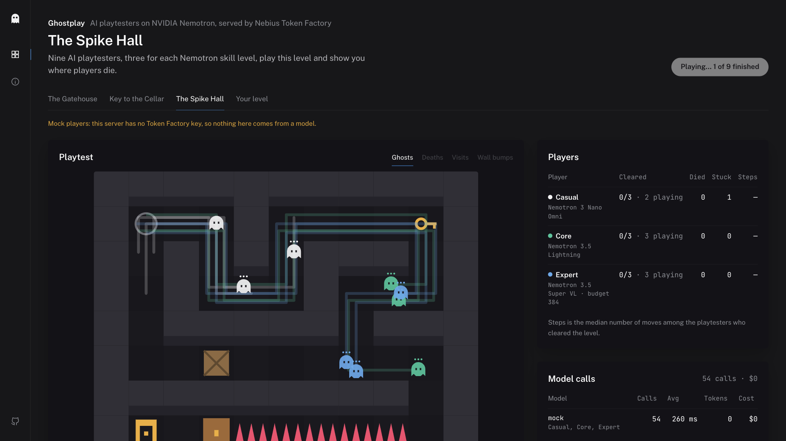
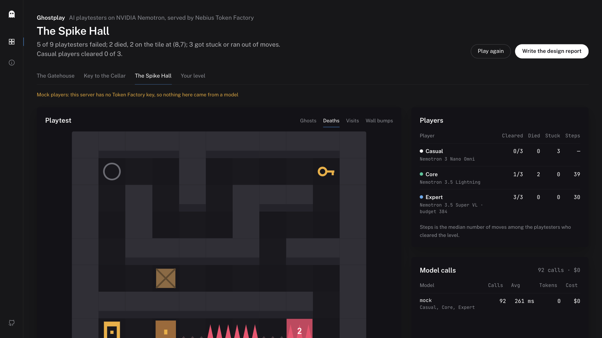
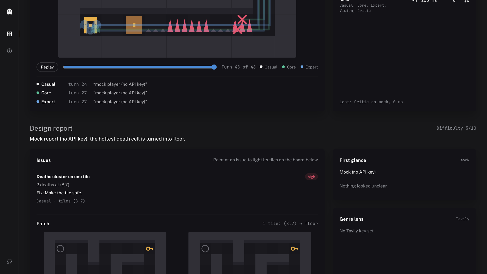
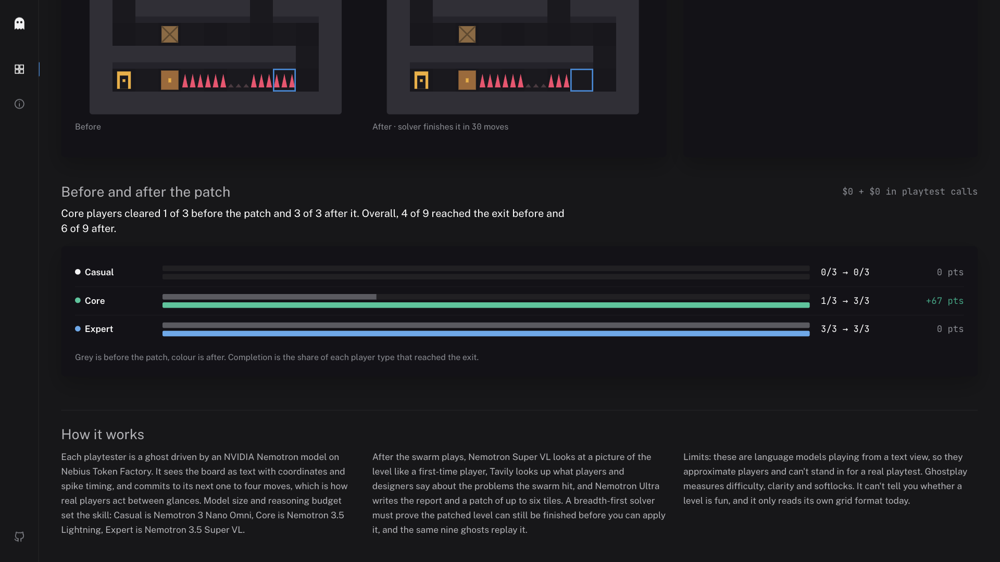
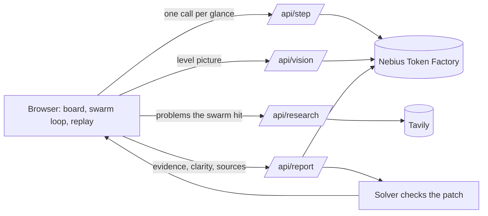

# Ghostplay

Nine AI playtesters play your game level, show you where players die and get stuck, fix the level, and prove the fix worked. Each playtester is built to be an NVIDIA Nemotron model on Nebius Token Factory, and the size of the model is the skill of the player.

[](LICENSE)

**Live demo (mock players):** _DEMO_URL_ · **Video:** _VIDEO_URL_ · Built for the Nebius x NVIDIA Global AI Hackathon (Best Apps and Agents).



## Status: running on mock players

I'm in Sri Lanka, and Nebius Token Factory doesn't accept cards issued here yet. Nebius staff confirmed this on the hackathon Discord on 28 and 29 October 2026, so I never got an API key. Every run in the demo and the video uses mock players. The app labels them on screen ("Mock players: this server has no Token Factory key, so nothing here comes from a model"). The mocks follow the solver's route with random, persona-shaped mistakes so the whole interface can be exercised. The mock design report just clears the tile where the most players died.

The real path is written and tested against the Token Factory API shape, but it has never answered a live call:

| Step | Code | Model on Token Factory |
|---|---|---|
| Pick models | `resolveModels()` in [`lib/nebius.js`](lib/nebius.js) reads `GET /v1/models` and takes the first ID per role from [`lib/personas.js`](lib/personas.js) | |
| Each ghost's move | `decide()` in [`lib/player.js`](lib/player.js) → `chat()` → `POST /v1/chat/completions` with a JSON schema | `nvidia/Nemotron-3-Nano-Omni` (casual), `nvidia/Nemotron-3_5-Lightning` (core), `nvidia/Nemotron-3.5-Super-VL` with a 384-token reasoning budget (expert) |
| First-glance check | [`api/vision.js`](api/vision.js), PNG of the level as `image_url` | `nvidia/Nemotron-3.5-Super-VL` |
| Design report and patch | `critique()` in [`lib/critic.js`](lib/critic.js), 2,048-token reasoning budget, strict JSON schema, solver-checked patch | `nvidia/Nemotron-3-Ultra-550b-a55b` |

To switch to the real models, put a key in `.env` (`NEBIUS_API_KEY=...`) or in your host's environment variables. No code changes. `npm run smoke` lists the Nemotron models your key can reach and checks JSON output and the thinking switch for each role.

## The problem

I make small mobile and web games at StarFun Games. The difficulty spike that ruins level 3 is always found by players after launch, in one-star reviews, never by me: I know the level too well to play it like a stranger. Getting strangers is hard for a solo developer. Google Play even makes new personal developer accounts run a closed test with at least 12 testers for 14 days before they can publish ([Play Console Help](https://support.google.com/googleplay/android-developer/answer/14151465)).

Ghostplay is built to give you a first round of strangers in a minute or two, before you spend those testers on it.

## What it does

1. Nine ghosts play the level: three casual players, three core players and three experts. Each ghost sees the board as text (coordinates, spike timing, legal moves) and commits to its next one to four moves, the way a real player acts between glances.
2. You see where it breaks: heatmaps of deaths, visits and wall bumps, completion by player type, and a replay you can scrub turn by turn.
3. A vision model looks at a picture of the level for "two seconds", like a new player, and says what is unclear.
4. Tavily searches and reads what players and designers say about the problems the swarm actually hit.
5. Nemotron Ultra reads every run and writes a design report: the issues, with evidence and tile coordinates, plus a patch of up to six tiles.
6. A breadth-first solver has to show the patched level can still be finished before you can apply the patch. The same nine ghosts then replay it, and you get completion before and after.

You can paint your own level in the editor and run the whole loop on it.

| Where they die | The report and its patch | Before and after the patch |
|---|---|---|
|  |  |  |

## How it uses NVIDIA Nemotron and Nebius Token Factory

Every model call goes to the Token Factory OpenAI-compatible endpoint (`https://api.tokenfactory.nebius.com/v1`) in [`lib/nebius.js`](lib/nebius.js). The size of the model and its reasoning budget decide how well each player plays:

| Role | Model (first available) | Settings | Why |
|---|---|---|---|
| Casual player | `nvidia/Nemotron-3-Nano-Omni` | temperature 1.0, thinking off, plans 4 moves | Small and fast, skims like a casual player; most calls go here |
| Core player | `nvidia/Nemotron-3_5-Lightning` | temperature 0.6, plans 3 moves | The everyday player |
| Expert player | `nvidia/Nemotron-3.5-Super-VL` | thinking on, reasoning budget 384 | Plans ahead and times spikes |
| First-glance check | `nvidia/Nemotron-3.5-Super-VL` | image input, JSON schema | It needs pixels |
| Designer-critic | `nvidia/Nemotron-3-Ultra-550b-a55b` | thinking on, reasoning budget 2,048, JSON schema | One long, high-stakes call over all the evidence |

- At startup the server reads `GET /v1/models` and picks the first preferred model per role that Token Factory serves today ([`lib/personas.js`](lib/personas.js)). Two Nemotron 3 serverless IDs retire on 9 Nov 2026, before judging, so nothing is hard-wired to them.
- Moves and reports use `response_format` JSON schema. If an endpoint rejects a field, the client drops it, retries once and remembers that, so the app degrades instead of failing.
- The reasoning budget is sent as `chat_template_kwargs` (`enable_thinking`, `reasoning_budget`).
- Each player call commits to several moves, so a full run takes about 90 calls in mock runs instead of 400+. The browser paces calls to Token Factory's default 60 requests a minute, slows down when the `x-ratelimit-remaining-requests` header runs low, and retries a 429 with backoff, so a run takes a minute or two and is never cut off halfway.
- The "Model calls" panel lists each model, how many calls it made, its average latency, tokens and cost.

No real-run numbers yet: see the status note at the top.

## Tavily

[`lib/tavily.js`](lib/tavily.js) runs one `search` and one `extract` per report. The query is built from what the swarm hit (timed hazard deaths, softlocks, unclear paths), and Nemotron Ultra may cite the sources it used.

## Architecture



The game rules live in one deterministic engine ([`lib/engine.js`](lib/engine.js)) shared by the browser, the API and the solver ([`lib/solver.js`](lib/solver.js)), so a move means the same thing everywhere. The swarm loop ([`lib/swarm.js`](lib/swarm.js)) runs in the browser, which keeps every serverless call short and lets the ghosts animate as answers arrive.

## Run it yourself

Needs Node 22 or newer.

```bash
git clone https://github.com/Harindulk/ghostplay && cd ghostplay
npm install
cp .env.example .env   # add NEBIUS_API_KEY, and TAVILY_API_KEY for the genre lens
npm run smoke          # checks your key, lists the Nemotron models, tests JSON and thinking per role
npm run api            # API on http://localhost:8787
npm run dev            # app on http://localhost:5173
npm test               # engine, solver and swarm tests
```

Without a key the API answers with clearly labelled mock players, so you can work on the UI offline.

**Deploy:** import the repo on Vercel and set the variables from `.env.example`. `LIVE_MODE_ENABLED`, `DAILY_LIVE_CAP`, `RUNS_PER_HOUR`, `CALLS_PER_RUN` and `REPORTS_PER_HOUR` cap what the public demo can spend.

## Level format

```json
{
  "name": "The Spike Hall",
  "grid": ["#####", "#@^E#", "#####"],
  "spike": { "period": 3, "on": 2 },
  "spikes": [{ "x": 2, "y": 1, "phase": 0 }]
}
```

`#` wall, `.` floor, `@` start, `E` exit, `k` key, `D` door (needs the key), `^` spike, `C` pushable crate. A spike at (x,y) is up on turn t when `(t + phase) % period < on`.

## Limitations

- These are language models playing from a text view. They approximate players and can't stand in for a real playtest.
- Ghostplay measures difficulty, clarity and softlocks, not fun.
- It reads its own grid format only. Real engines (Unity tilemaps, Tiled maps) are on the roadmap.
- The public demo's limits are kept in memory per server instance, so they are approximate.

## Roadmap

- Import Tiled and Unity tilemaps.
- Batch swarms of hundreds of ghosts on Nebius Serverless Jobs for statistically solid completion rates.
- Fine-tune persona players on real player traces with Token Factory fine-tuning.

## License

MIT, see [LICENSE](LICENSE).
